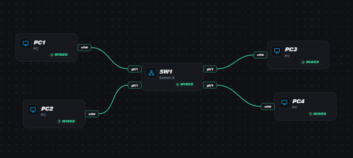
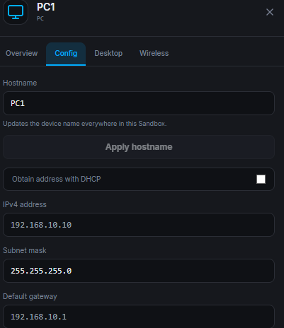
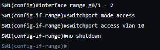
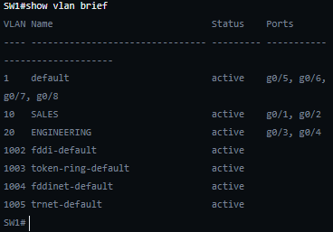
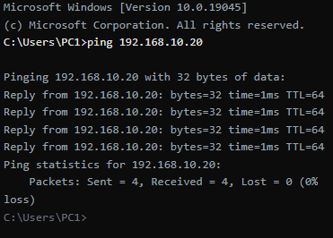
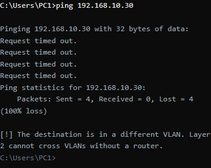

<h1>Creating VLAN</h1>

Source of the exercise: <a href = "https://www.google.com/url?sa=t&rct=j&q=&esrc=s&source=web&cd=&cad=rja&uact=8&ved=2ahUKEwjB2MiHh4CYAxXemuEIHVbhPDkQFnoECA8QAQ&url=https%3A%2F%2Fswitchlab.dev%2F&usg=AOvVaw39b5Eu7UHf67JXucXUMOql&opi=89978449">Switchlab</a>

<strong>GOAL: </strong> Build one office switch, separate Sales and Engineering into VLANs, then prove what Layer 2 isolation changes.

<h2>Stets Taken: </h2>

<strong>Step 1:</strong> Add a switch

<strong>Step 2:</strong>	Add 2 PC both SALES and ENGINEERING department

<strong>Step 3:</strong> Connected each PC using ethernet and assigned each PC g0/1 – 4 accordingly. 

<strong>Step 4:</strong>	Apply a static IP and Subnet mask to all the PC

<strong>Step 5:</strong>	After assigning IP to the PC, it is time to add them to what department. Adding the SALES department into the switch access port and making sure that the connection is enable 

<strong>Step 6:</strong>	Ensure that the PC’s are in the correct VLAN using show vlan brief on the privilege mode

<strong>Step 7:</strong>	Use PC 1 to ping PC 2 and PC3 ping PC4 to ensure that both connection/VLAN are working 

<strong>Step 8:</strong>	Use PC1 to ping PC3 to ensure that the two VLAN’s cannot ping one another, to make sure that the two network are actually separated despite being connected to the same switch 

<h2>What I learned</h2>
<ul>
  <li>Increase familiarity with the CISCO CLI (Command Line Interface) </li>
  <li>Creating VLAN’S and adding devices in it</li>
  <li>I learned that aside from doing the job, verifying the work is a big part of it to ensure that everything is taken care of. </li>
</ul>
